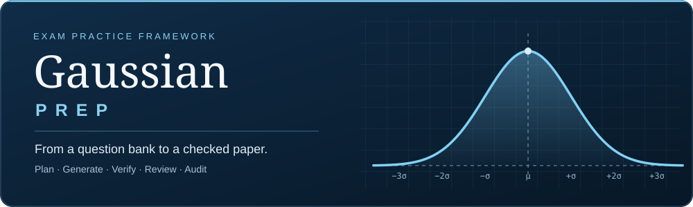
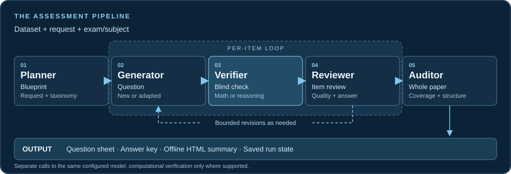
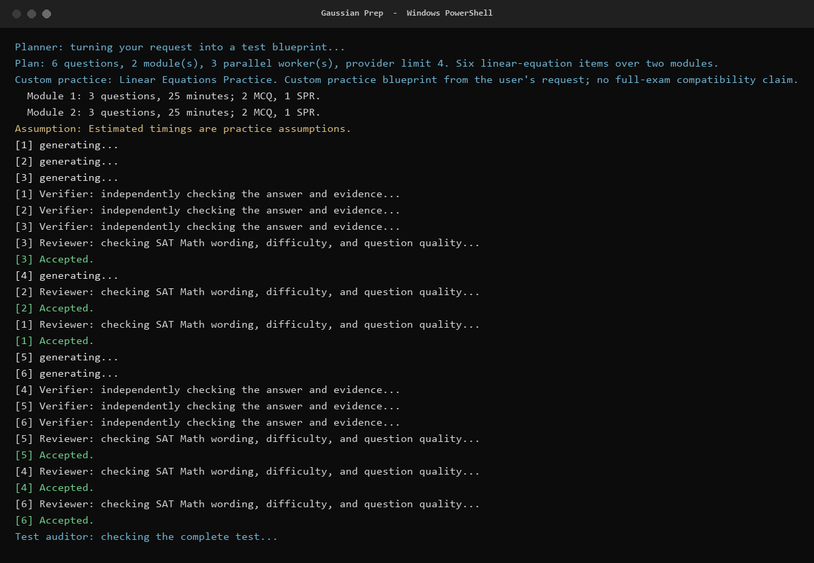
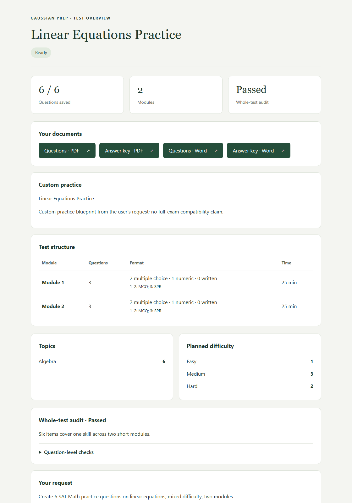
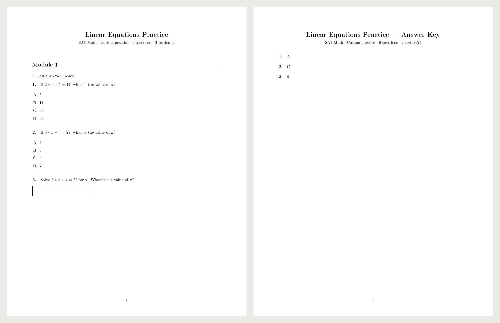

<p align="center">
  
</p>

# Gaussian Prep

Gaussian Prep builds exam practice from a question dataset and a plain-language request. It plans the paper, generates or adapts questions, checks answers, reviews individual items, and audits the completed set. It exports a question sheet and separate answer key as PDF or DOCX, with an offline HTML summary.

The planner, generator, verifier, reviewer, and auditor use separate calls to the same model. Supported mathematical answers are checked with SymPy; other tasks rely on model reasoning and review. These checks do not guarantee correct answers, official exam alignment, originality, or calibrated difficulty. Review the material before using it with students.

<p align="center">
  <a href="#requirements-and-setup">Get started</a> ·
  <a href="#basic-usage">Usage</a> ·
  <a href="#how-the-engine-works">Pipeline</a> ·
  <a href="#saved-runs-and-recovery">Outputs &amp; recovery</a> ·
  <a href="docs/reference.md">Technical reference</a>
</p>

<p align="center">
  
  
  
  <a href="LICENSE"></a>
</p>

## At a glance

| **5 roles** | **2 generation modes** | **3 question formats** | **100 questions** |
| :---: | :---: | :---: | :---: |
| Separate model calls | New or source-based | MCQ · SPR · FRQ | Maximum per practice run |

Gaussian PREP is designed for building practice material from an existing structured question bank, not for replacing teachers, official exam specifications, or human review.

## How the engine works



| Role | Responsibility |
| --- | --- |
| **01 · Planner** | Builds the assessment blueprint from the request, dataset taxonomy, and available structure; reports conflicts instead of inventing missing requirements. |
| **02 · Generator** | Creates a new item or adapts an assigned source item to its slot. |
| **03 · Independent verifier** | Solves the student-facing question without seeing the proposed key or solution; uses symbolic computation where supported. |
| **04 · Item reviewer** | Checks wording, alignment, difficulty, answer correctness, and originality or source faithfulness. |
| **05 · Test auditor** | Checks the assembled paper for repetition, coverage, workload, format mix, and structural consistency; may request targeted replacements. |

> [!IMPORTANT]
> Separate role prompts do not mean independent models. A model-generated interpretation can be wrong even when a symbolic computation is correct. Unsupported mathematical tasks and written responses rely on independent subject reasoning and review; these are not mathematical proofs of correctness.

The [role specifications](docs/reference.md#the-five-roles), [math checker](docs/reference.md#the-math-checker), and [structure contract](docs/reference.md#mocks-practice-and-the-structure-contract) describe the checks and their boundaries in detail.

## Gaussian PREP in action



## Requirements and setup

- Python 3.11 or newer.
- A question dataset in JSON, JSONL, or CSV. PDF and image-only question banks are not imported.
- Access to a configured model provider, or a local Ollama server with a suitable model.
- Tcl/Tk if you want the dataset file chooser. Supplying a dataset path avoids the chooser.

The launch scripts use Windows and PowerShell. You can also start the Python program directly, but this release has not been validated on macOS or Linux.

From the project folder, create the environment and install the project:

```powershell
.\setup.ps1 -PythonPath C:\path\to\python.exe
```

Then double-click `START.cmd` or run:

```powershell
.\run.ps1
```

For an existing Python environment, install with `python -m pip install .` and run `python -m gaussian_prep`. Keep `PROMPTS.md` in the working directory if you want its editable examples and planner guidance; it is optional.

A LaTeX engine is optional. PDF export tries `pdflatex`, `xelatex`, `lualatex`, then Tectonic. If compilation fails or no engine is available, it uses the built-in PDF renderer and retains the LaTeX source. DOCX does not require LaTeX. Font coverage and layout vary between renderers.

## Basic usage

The interactive flow selects a dataset, asks for the exam and subject, takes your request, and asks for a provider, model ID, and API key. Use `SAT Math` or `SAT Verbal` explicitly for SAT material.

```powershell
.\run.ps1 generate "Generate 4 questions on linear equations: 3 MCQ and 1 open-ended." --dataset data\questions.json --prep-material "SAT Math"
```

Inspect a dataset without credentials or model calls:

```powershell
.\run.ps1 inspect data\questions.json --report dataset-report.json
```

The loader accepts a JSON array, a JSON object containing `questions` or `records`, JSONL records, or CSV rows. Typical fields are `question_id`, `domain`, `subskill`, `difficulty`, `format`, `question`, `choices`, and `answer`. Passages, structured tables, and geometric figures are supported. The [reference](docs/reference.md#datasets) lists aliases and validation rules. No dataset is bundled; use material you are entitled to process and share.

SAT Math and recognized quantitative subjects generate new questions using the dataset as a reference. SAT Verbal, reading, language, history, and unrecognized subjects adapt source questions, preserving the passage, stem, table, and figure. All source records remain in the dataset; quality flags are advisory.

Use **practice** for a custom count and topic selection, up to 100 questions. Use **mock** for a complete exam, section, or named paper with a defined structure. A dataset may supply `exam_structure` metadata. Structure conflicts block completion. See [PROMPTS.md](PROMPTS.md) for request examples.

### Choose the right request

| Mode | What to request | What the system preserves |
| --- | --- | --- |
| **Practice** | A focused drill, a custom question count, or a shortened mock | Your requested topics, count, and format mix |
| **Mock** | A complete exam, subject section, or named paper | The defined sections, timing, sequence, choice counts, and applicable quotas |

| Subject profile | Approach |
| --- | --- |
| SAT Math and recognized quantitative subjects | Write new questions with the dataset as reference. |
| SAT Verbal and reading, language, writing, literature, history, or unrecognized subjects | Adapt distinct source questions; retain passage, stem, table, and figure. |

Examples from the [request guide](PROMPTS.md):

- **SAT Math:** Build a 44-question, two-module practice test with 35 minutes per module, all four domains, and approximately 75% MCQ and 25% numeric SPR.
- **AP Biology:** Create six multiple-choice questions and two written-response questions about cell membranes.
- **ACT English:** Adapt ten existing questions and their associated passages while preserving the original tasks.

These are example requests, not assurances of official exam conformity. Actual results depend on the supplied dataset, model and request.

### What can be checked?

| Format | Verification approach |
| --- | --- |
| **MCQ** — multiple choice | Supported mathematics: compute the answer and compare all options; require exactly one keyed correct choice and distinct mathematical options. |
| **SPR** — student-produced response | Supported mathematics: compare the numeric result against the key. |
| **FRQ** — free response | Independent subject reasoning and item review, not symbolic proof. |

See [dataset fields and aliases](docs/reference.md#datasets) before preparing your question bank.

## Configuration

One provider, model, and key serve all five roles. OpenCode Go is the default; the [provider table](docs/reference.md#providers-and-models) lists the built-in endpoints and environment prefixes.

Set `<PREFIX>_MODEL` and `<PREFIX>_API_KEY` to avoid credential prompts, and pass `--provider`, `--prep-material`, a request, and `--format` for an unattended run. Model IDs must contain only letters, digits, periods, underscores, or hyphens. Available models and account quotas are not checked against a provider catalog.

The custom provider reads `CUSTOM_BASE_URL`; use a trusted HTTPS endpoint for remote services. Ollama uses `http://localhost:11434/v1` and needs no API key. Dataset selection can also come from `GAUSSIAN_DATASET`, with `SATPREP_DATASET` retained for compatibility. The app does not load `.env` files automatically.

The default budget is 400 model calls per invocation. An uncomplicated run needs roughly `3 × question count + 2` calls; retries and revisions add more. `--max-calls` changes the budget, `--revisions` controls item revisions, and `--audit-revisions` controls audit replacement rounds. Concurrency settings are local heuristics, not guarantees about a provider's current limits.

## Saved runs and recovery

Runs are saved under `runs/<timestamp>/` unless you supply `--out`:

```text
summary.html
questions.pdf / questions.docx
answer-key.pdf / answer-key.docx
support/
  state.json
  diagnostics/
  sources/
  rendering/
  recovery/
```

Only selected export formats are written. Keep `support/` with the run so it can be resumed or exported again. To continue:

```powershell
.\run.ps1 resume runs\20260101-120000-000000
```

Resume requires the original dataset contents, checked by hash. If the dataset moved, the app asks you to locate it. Local recovery rechecks saved work and backs up changed checkpoints before continuing. Accepted questions are reused; unfinished items or audits may need more model calls. Ctrl+C stops the run and keeps checkpointed work.

A completed run can retain whole-test audit warnings after its replacement budget is exhausted. Completion means the per-item checks passed and the audit ran, not that every audit concern was resolved.

### Inside a completed run

| Artifact | Who or what it is for |
| --- | --- |
| `questions.pdf` / `questions.docx` | Student-facing paper without answers. |
| `answer-key.pdf` / `answer-key.docx` | Separate keyed responses, exact numeric answers or model written responses. |
| `summary.html` | Offline inspection of the result and audit findings, including the distinction between computation and subject reasoning. |
| `support/` | Checkpoint, diagnostics, source and rendering material, and recovery information; keep private by default. |

### Output gallery

**01 / Run summary** — inspect a completed run and its audit results.



**02 / Exported documents** — distribute the student paper and keep the answer key separate.



## Privacy and security

Selected dataset examples, requests, and generated content are sent to the chosen provider. Its data policies apply. Diagnostic files save request payloads and provider responses; checkpoints also contain the dataset's absolute path. Run summaries repeat your request. Treat the entire run folder as private until you have reviewed it for sharing.

The app omits authentication headers from its logs and does not deliberately save the configured API key. That does not make logs anonymous or safe to publish: provider responses and user content may contain sensitive information. Keep keys out of datasets, prompts, screenshots, and committed files. Store private datasets under the ignored `data/` folder and keep runs under the ignored `runs/` folder.

Mathematical expressions use a restricted parser and a computation subprocess with a timeout. Native TeX inputs are filtered and conventional compilers receive `-no-shell-escape`. These controls are not an operating-system sandbox. Use trusted local installations of Python and LaTeX, and do not resume checkpoints from untrusted sources.

## Development

```powershell
.\.venv\Scripts\python.exe -m pip install -e ".[dev]"
.\.venv\Scripts\python.exe -m pytest -q
.\.venv\Scripts\python.exe -m pip check
.\.venv\Scripts\python.exe -m pip wheel . --no-deps --wheel-dir dist
```

Tests cover mathematical checks, scripted provider responses, generation and recovery, rendering security, PDF/DOCX exports, and command-line behavior. A native compilation test skips when no LaTeX engine is available. Tests make no paid model calls. There is no configured formatter, linter, type checker, or vulnerability-database audit command.

Application code lives in `src/gaussian_prep/`, tests in `tests/`, and detailed documentation in `docs/`. The [reference](docs/reference.md) describes the role schemas, structure checks, rendering rules, command-line options, and limitations.

## Explore the repository

| Path | Responsibility |
| --- | --- |
| [`cli.py`](src/gaussian_prep/cli.py) | Interactive and command-line entry points |
| [`corpus.py`](src/gaussian_prep/corpus.py) | Dataset ingestion and retrieval |
| [`prep.py`](src/gaussian_prep/prep.py) | Subject profiles and generation mode |
| [`pipeline.py`](src/gaussian_prep/pipeline.py) | Role orchestration and revision flow |
| [`prompts.py`](src/gaussian_prep/prompts.py) | Role-specific model instructions |
| [`structure.py`](src/gaussian_prep/structure.py) | Assessment structure checks |
| [`verification.py`](src/gaussian_prep/verification.py) and [`expressions.py`](src/gaussian_prep/expressions.py) | Mathematical verification and restricted expression handling |
| [`export.py`](src/gaussian_prep/export.py) and [`render.py`](src/gaussian_prep/render.py) | Document generation and rendering |
| [`recovery.py`](src/gaussian_prep/recovery.py) | Local run recovery |
| [`tests/`](tests/) | Automated test suite |

## Documentation and license

- [Request guide](PROMPTS.md) — write better practice and mock requests.
- [Technical reference](docs/reference.md) — detailed behavior, supported providers, command options and limitations.
- [Command reference](docs/reference.md#command-reference) — available CLI options.
- [Limits](docs/reference.md#limits) — known constraints of the framework.
- [Apache License 2.0](LICENSE) and [NOTICE](NOTICE) — licensing and attribution.

---

<p align="center">
  
</p>

<p align="center"><sub>Gaussian PREP · Originally created by Emil Valiyev</sub></p>
